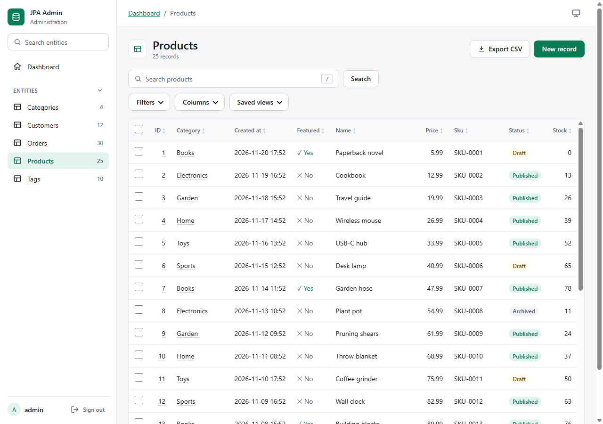

# JPA Super Admin

[](https://github.com/mdmusahub/JPA-SUPER-ADMIN/actions/workflows/ci.yml)
[](https://central.sonatype.com/artifact/io.github.mdmusahub/springboot-super-admin)
[](LICENSE)

An open-source admin console for Spring Boot. Add one dependency, set two properties, open `/admin`, and manage every JPA entity of your application, much like Django Admin. Entities are discovered automatically; there is nothing to register and no front-end build.

**Version 0.1.0.** Spring Boot 4.1 and Java 17 or newer. Documentation: <https://mdmusahub.github.io/JPA-SUPER-ADMIN/>. What changed: [CHANGELOG.md](CHANGELOG.md).



|  |  |
|---|---|
|  |  |
|  | |

## What you get

- A dashboard with record counts and a "Records created" chart, and a grouped sidebar of every entity.
- Lists with search, sorting, paging, per-field filters, column visibility, saved views (kept in your browser) and CSV export.
- Detail pages, create, edit, duplicate, delete and bulk delete, with validation errors next to the fields and an unsaved-changes guard.
- File and image uploads with a local storage provider and a storage interface for your own.
- Sensitive fields (passwords, tokens, keys) are masked everywhere: in lists, forms, exports, logs and errors.
- A separate sign-in with one administrator, CSRF protection on every change, and a security chain that never touches your own application's rules.
- Light and dark theme, a phone layout, keyboard use (`/` jumps to the search box) and a measured contrast of at least 4.5 to 1 for text.

## Quick start (about five minutes)

Requirements: Java 17 or newer, a Spring Boot 4.1 application with Spring Data JPA.

1. **Add the starter** from Maven Central. It is a pom-only artifact (it carries the dependencies and no code), so the dependency needs `<type>pom</type>`; without that line Maven looks for a jar that does not exist:

   ```xml
   <dependency>
       <groupId>io.github.mdmusahub</groupId>
       <artifactId>springboot-super-admin</artifactId>
       <version>0.1.0</version>
       <type>pom</type>
   </dependency>
   ```

2. **Set the two required properties.** The password is hashed with BCrypt at startup and never logged; use at least 12 characters (under the `prod` profile a weak password stops startup):

   ```yaml
   jpa:
     admin:
       username: admin
       password: ${ADMIN_PASSWORD}
   ```

3. **Start your application and open `http://localhost:8080/admin`.** Sign in and manage your entities. A missing username or password stops startup with a message that says what to add.

To see it with demo data first, build and run the sample application (do not use `spring-boot:run` without `-am`, it can run stale jars):

```powershell
mvn -pl sample-app -am package -DskipTests
$env:JPA_ADMIN_USERNAME = 'admin'
$env:JPA_ADMIN_PASSWORD = '<12 or more characters>'
java -jar sample-app/target/sample-app-0.1.0.jar
```

## Configuration at a glance

| Property | Default | Meaning |
|---|---|---|
| `jpa.admin.username`, `jpa.admin.password` | none | Required |
| `jpa.admin.path` | `/admin` | Where the console lives |
| `jpa.admin.title` | `JPA Admin` | Header and sign-in title |
| `jpa.admin.primary-color` | `#0d9f6e` | Accent colour, `#rrggbb` |
| `jpa.admin.page-size` | `25` | Rows per page: 10, 25, 50 or 100 |
| `jpa.admin.excluded-entities` | none | Entities to hide |
| `jpa.admin.sensitive-fields` | `password, secret, token, apikey` | Names that are always masked |
| `jpa.admin.export-enabled`, `export-max-rows`, `export-bom` | `true`, `50000`, `false` | CSV export |
| `jpa.admin.storage.*`, `jpa.admin.upload.signing-key` | local `./uploads`, 5MB | File uploads |

Every wrong value stops startup with a message that names the property. The full reference is in `docs/PROJECT_DOCS.md` (section B4).

## Make it fit your entities

All annotations are optional (package `io.github.mdmusahub.jpaadmin.annotation`):

```java
@Entity
@AdminResource(plural = "People", deletable = false)   // headings say "People"; records cannot be deleted
public class Person {

    @Enumerated(EnumType.STRING)
    @AdminBadge({"ACTIVE=green", "PENDING=amber", "BANNED=red"})   // badge colours: green, amber, red, grey
    private PersonStatus status;

    @ManyToOne
    @AdminLookup("email")                                // show the related record by its email
    private Company company;

    @AdminSensitive                                      // masked everywhere
    private String recoveryCode;

    @AdminUpload(folder = "avatars", maxSize = "2MB")    // a file field
    private String avatar;
}
```

`@AdminHidden` removes an entity or a field from the console completely. See `docs/PROJECT_DOCS.md` (section B9) for every option and its default.

## Documentation

- **The documentation site:** <https://mdmusahub.github.io/JPA-SUPER-ADMIN/> (installation, configuration, using the console, annotations, file uploads, security, deployment, troubleshooting, limitations and roadmap).
- **Project papers, in this repository:** [docs/PLAN.md](docs/PLAN.md) (scope, architecture, routes, phases), [docs/RULES.md](docs/RULES.md) (the engineering and security rules), [docs/PROJECT_DOCS.md](docs/PROJECT_DOCS.md) (requirements and the drafts of the user documentation), [docs/UI_PLAN.md](docs/UI_PLAN.md) (how the interface is built), [docs/DECISIONS.md](docs/DECISIONS.md) (every design decision with its reason) and [CHANGELOG.md](CHANGELOG.md).
- **Build everything and run all tests:** `mvn clean verify` (about 20 minutes). The real-browser tests use a Chrome or Edge on the machine (or `-Dtest.chrome=<path>`) and the PostgreSQL and MySQL tests use Docker; each is skipped, with the reason, when it is missing. See [CONTRIBUTING.md](CONTRIBUTING.md).

## Security notes

The console is a high-value target: serve it over HTTPS, set `Secure` and `SameSite` on your session cookie yourself (the console never changes global cookie settings), and put it behind a VPN or an IP allow-list when it faces the internet. Login rate limiting is planned for v0.2.

To report a vulnerability, **do not open a public issue**: see [SECURITY.md](SECURITY.md) (GitHub private vulnerability reporting, or email).

## Contributing and licence

Bug reports, ideas and patches are welcome: read [CONTRIBUTING.md](CONTRIBUTING.md) first, and please follow the [Code of Conduct](CODE_OF_CONDUCT.md). JPA Super Admin is released under the [Apache License 2.0](LICENSE).

## About the author

I'm Musa Malik, a Java and Spring Boot developer who likes building tools that save other developers time.

**Tech I work with:** Java · Spring Boot · Spring Security · JPA/Hibernate · Maven · PostgreSQL · MySQL

**Get in touch:** [github.com/mdmusahub](https://github.com/mdmusahub), or by email at [mdmusaalam98019@gmail.com](mailto:mdmusaalam98019@gmail.com). For a bug or an idea, an [issue](https://github.com/mdmusahub/JPA-SUPER-ADMIN/issues) is best.
