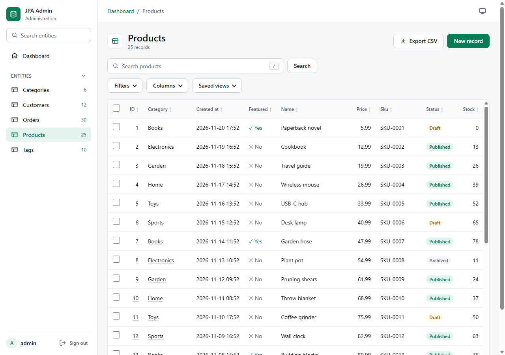
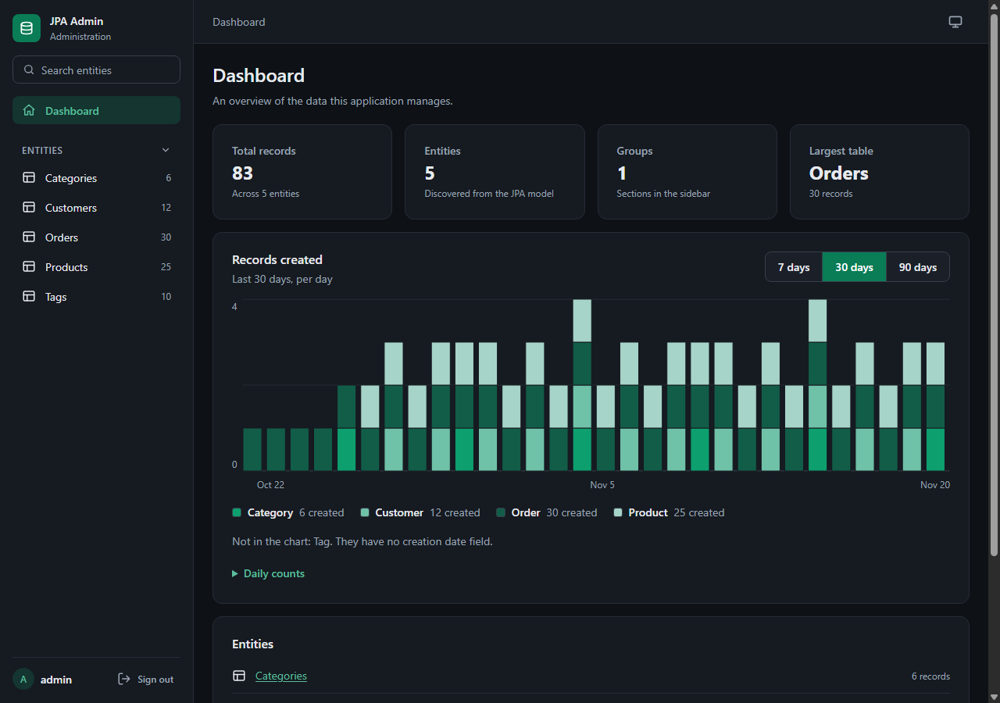
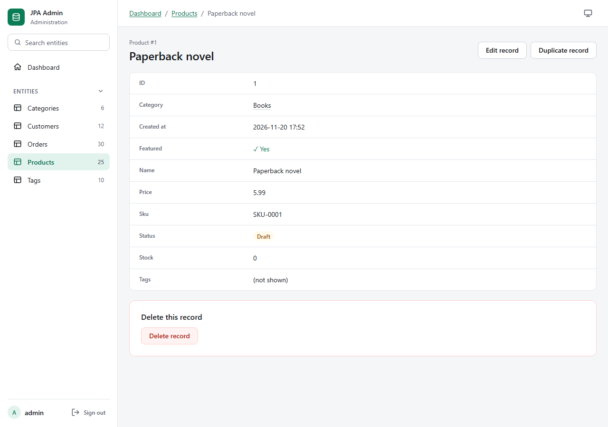

# JPA Super Admin

**JPA Super Admin** gives your Spring Boot application a complete admin console. Add one dependency, set an admin username and password, and manage all your data in the browser, much like Django Admin. Entities are discovered automatically: there is nothing to register and no front-end build.

## What you get

- A dashboard with record counts and a "Records created" chart, and a grouped sidebar of every entity.
- Lists with search, sorting, paging, per-field filters, column visibility, saved views (kept in your browser) and CSV export.
- Detail pages, create, edit, duplicate, delete and bulk delete, with validation errors next to the fields and an unsaved-changes guard.
- File and image uploads with a local storage provider and a storage interface for your own.
- Sensitive fields (passwords, tokens, keys) masked everywhere: in lists, forms, exports, logs and errors.
- A separate sign-in with one administrator, CSRF protection on every change, and a security chain that never touches your own application's rules.
- Light and dark theme, a phone layout, keyboard use and a measured text contrast of at least 4.5 to 1.

| | |
|---|---|
|  |  |

## Five minutes to a console

1. [Add the starter](installation.md) to your Spring Boot 4.1 application (Java 17 or newer, Spring Data JPA).
2. Set `jpa.admin.username` and `jpa.admin.password`.
3. Start the application and open `/admin`.

Want to look first? [Run the sample application](run-the-sample.md): a small shop with demo data.

## Where to go next

| I want to... | Read |
|---|---|
| Install it and sign in | [Installation](installation.md) |
| Try it with demo data | [Run the sample](run-the-sample.md) |
| Change a setting | [Configuration](configuration.md) |
| Learn what the console can do | [Using the console](using-the-console.md) |
| Rename, hide, mask or colour things | [Customizing entities](customizing-entities.md) and [Annotations](annotations.md) |
| Let people upload images and documents | [File uploads](file-uploads.md) |
| Know how it is protected, and protect it | [Security](security.md) and [Deployment](deployment.md) |
| Fix a problem | [Troubleshooting](troubleshooting.md) |
| Know what it does not do yet | [Limitations and roadmap](limitations-and-roadmap.md) |
| Help build it | [Architecture](architecture.md), [Development](development.md), [Release guide](release-guide.md) |

## About this release

This is version **0.1.0**, for **Spring Boot 4.1** and **Java 17 or newer**. Spring Boot 3.x is not supported. Version 0.1 has one administrator, no audit log and no S3 storage; those are on the [roadmap](limitations-and-roadmap.md#roadmap). The source, the issue tracker and the changelog are on [GitHub](https://github.com/mdmusahub/JPA-SUPER-ADMIN); the project is released under the Apache License 2.0.
